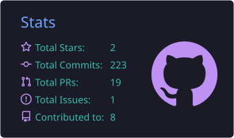
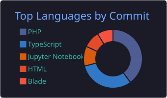
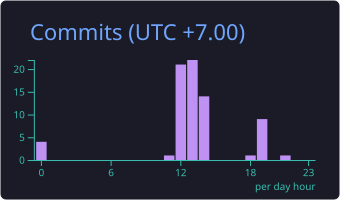
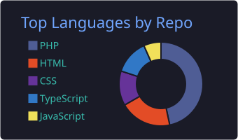

 

### About

Web developer with an interest in data. I build web apps with Laravel, Android apps with Jetpack Compose, and scraping and automation tools with Python. I use AI tools heavily in my workflow and actively build with AI agents.

### Stack & AI Tools

  

### GitHub Stats

### Contributions

<picture>
  <source media="(prefers-color-scheme: dark)" srcset="https://raw.githubusercontent.com/wilrel/wilrel/output/snake-dark.svg" />
  <source media="(prefers-color-scheme: light)" srcset="https://raw.githubusercontent.com/wilrel/wilrel/output/snake.svg" />
  
</picture>

