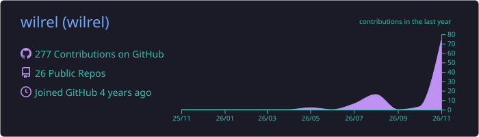

  
  

---

### About

Web developer with an interest in data. I build web apps with Laravel, Android apps with Jetpack Compose, and scraping and automation tools with Python. I use AI tools heavily in my workflow and actively build with AI agents.

---

### Stack & AI Tools

  

---

### GitHub Stats

---

### Contributions

<picture>
  <source media="(prefers-color-scheme: dark)" srcset="https://raw.githubusercontent.com/wilrel/wilrel/output/github-contribution-grid-snake-dark.svg" />
  <source media="(prefers-color-scheme: light)" srcset="https://raw.githubusercontent.com/wilrel/wilrel/output/github-contribution-grid-snake.svg" />
  
</picture>

---

### Contact

<!-- Replace with your LinkedIn username, or remove this line -->

